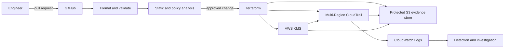

# SecureFlow: Evidence-Driven DevSecOps Control Plane on AWS

SecureFlow is a reference implementation for governing cloud infrastructure changes as testable security hypotheses. It provisions a tamper-evident AWS audit-logging foundation with Terraform and evaluates proposed changes through deterministic CI controls.

The project is more than a collection of scanners. It demonstrates how a senior DevSecOps engineer translates threat scenarios into preventive, detective, and evidentiary controls; defines explicit assurance claims; and records residual risk instead of treating a green pipeline as proof of security.

> **Scope statement:** This repository is an educational reference architecture. It is not a complete production platform, certification, or guarantee of compliance. Production adoption requires organisation-specific threat modelling, control ownership, independent review, recovery testing, and continuous evidence collection.

## Executive summary

SecureFlow addresses a narrow but consequential problem: if an attacker compromises a privileged identity, can they disable audit coverage, alter stored evidence, or introduce insecure infrastructure without detection?

The design responds with four control layers:

1. **Change assurance** - formatting, validation, static analysis, and policy checks execute on pull requests and protected branches.
2. **Cryptographic governance** - customer-managed AWS KMS keys protect CloudTrail, S3, and CloudWatch Logs.
3. **Audit resilience** - multi-Region CloudTrail, global-service events, log-file validation, S3 versioning, retention controls, and CloudWatch delivery reduce forensic blind spots.
4. **Evidence transparency** - architecture decisions, threat assumptions, control mappings, limitations, and verification commands are maintained as versioned documentation.

## Research question and assurance argument

**Research question:** To what extent can infrastructure-as-code and automated policy gates reduce the probability that insecure changes or compromised administrative activity undermine AWS audit evidence?

The working hypothesis is:

> If cloud controls are expressed as reviewable code, evaluated before merge, and paired with independently queryable audit records, then material configuration weaknesses become easier to detect, reproduce, and remediate than in console-driven administration.

This hypothesis is falsifiable. SecureFlow is ineffective if a proposed change can bypass required checks, if CloudTrail stops delivering events without an observable signal, if an unauthorised principal can read or alter the evidence store, or if the documented deployment cannot be reproduced from a clean environment.

## System context



For trust boundaries, data flows, failure modes, and recovery considerations, see [Architecture](docs/architecture.md). For adversary assumptions and abuse cases, see [Threat model](docs/threat-model.md). For traceability from risk to implementation and evidence, see [Control matrix](docs/control-matrix.md).

## Design principles

- **Evidence before assertion:** every control claim identifies an implementation and repeatable verification method.
- **Least privilege:** permissions are scoped to required resources and service behaviours.
- **Secure by default:** public access is blocked, TLS is mandatory, versioning is enabled, and destructive operations have recovery windows.
- **Separation of concerns:** provider configuration, inputs, resources, and outputs are distinct Terraform units.
- **Deterministic delivery:** CI checks formatting rather than rewriting source and evaluates pull requests and the protected branch.
- **Risk-based governance:** exceptions require a rationale, owner, compensating control, and review date; silent scanner suppression is not accepted.
- **Defence in depth:** no scanner, encryption setting, or audit service is treated as sufficient alone.

## Security properties

| Property | Mechanism | Verification |
|---|---|---|
| Regional audit coverage | Multi-Region CloudTrail with global service events | `aws cloudtrail describe-trails` |
| Evidence integrity | CloudTrail log validation and S3 versioning | CloudTrail status and S3 versioning APIs |
| Confidentiality at rest | Customer-managed KMS encryption | Terraform review and AWS APIs |
| Confidentiality in transit | S3 bucket policies deny requests without TLS | IAM simulation or negative integration test |
| Public exposure prevention | S3 public-access blocks | S3 Public Access Block API |
| Change quality | Terraform checks, Trivy, and Checkov | GitHub Actions logs |
| Recovery from accidental deletion | Versioning, KMS deletion window, lifecycle retention | Recovery exercise in a sandbox |

## Repository structure

```text
.
├── .github/
│   ├── dependabot.yml
│   └── workflows/secure-pipeline.yml
├── docs/
│   ├── architecture.md
│   ├── control-matrix.md
│   └── threat-model.md
├── terraform/
│   ├── main.tf
│   ├── outputs.tf
│   ├── provider.tf
│   ├── variables.tf
│   └── .terraform.lock.hcl
├── .gitignore
└── README.md
```

## Prerequisites

- Terraform 1.6 or later
- AWS CLI v2
- An isolated AWS account or sandbox authorised to manage KMS, S3, IAM, CloudTrail, and CloudWatch Logs
- GitHub branch rules that require CI before merge

Do not use long-lived AWS access keys in GitHub. Deployment automation should use GitHub OpenID Connect and a reviewed assumable role. This repository validates infrastructure but intentionally does not auto-apply changes.

## Reproduce the validation

```bash
git clone https://github.com/AdeoyeEmmanuel2020/secureflow-devsecops.git
cd secureflow-devsecops

terraform -chdir=terraform init
terraform -chdir=terraform fmt -check -recursive
terraform -chdir=terraform validate
terraform -chdir=terraform plan -out=tfplan
```

Deploy only to an authorised sandbox:

```bash
terraform -chdir=terraform apply tfplan
```

The random suffix produces globally unique bucket names. Override `name_prefix`, `environment`, `aws_region`, retention periods, and tags through a reviewed `.tfvars` file. Never commit credentials or state.

## Post-deployment verification

```bash
aws cloudtrail get-trail-status --name secureflow-trail
aws s3api get-public-access-block --bucket <evidence-bucket>
aws s3api get-bucket-versioning --bucket <evidence-bucket>
aws kms get-key-rotation-status --key-id <kms-key-id>
aws logs describe-log-groups --log-group-name-prefix /aws/cloudtrail/secureflow
```

Validation is complete only when expected positive tests pass and negative tests demonstrate that insecure operations are denied. Suggested negative tests include unauthenticated S3 access, non-TLS S3 requests, and pull requests that remove encryption or public-access controls.

## CI/CD assurance model

The workflow runs on pull requests, pushes to `main`, and manual invocation. It uses least-privilege GitHub token permissions, cancels superseded runs, and executes:

1. Terraform initialisation without a backend.
2. Formatting in check-only mode.
3. Terraform validation.
4. Trivy configuration analysis with high and critical findings treated as failures.
5. Checkov policy analysis with hard failure.

Branch protection is an external control: administrators must require the workflow, independent review, conversation resolution, and restricted direct pushes.

## Compliance interpretation

The control matrix references common frameworks to support traceability, not to claim certification. A technical safeguard can contribute evidence to multiple frameworks, but organisational policies, people controls, asset inventories, supplier management, and independent audit remain outside this repository's scope.

## Known limitations and research extensions

- The design uses one AWS account; mature deployments should separate log archive, security tooling, and workloads with AWS Organizations.
- The evidence bucket and trail share a Terraform state. Production should separate administrative trust domains and protect state remotely.
- Object Lock, MFA Delete, Security Hub, GuardDuty, Config, alert routing, and automated response are not implemented.
- CI does not yet run Terratest, policy-unit tests, drift detection, or runtime integration tests.
- Versioned action tags are used; production governance should pin third-party actions to reviewed commit SHAs.
- Scanner findings are signals, not proof. False positives, false negatives, tool compromise, and policy gaps remain possible.

These are explicit research boundaries and a roadmap for controlled extension rather than hidden shortcomings.

## Cost and teardown

CloudTrail, CloudWatch Logs, KMS, and S3 can incur charges. Inspect the plan and AWS pricing before deployment. To remove sandbox resources:

```bash
terraform -chdir=terraform destroy
```

KMS deletion is delayed by design. Review evidence-retention and legal-hold requirements before destructive action.

## Governance and contribution

Changes should include a problem statement, threat or control impact, test evidence, documentation update, and rollback strategy. Security exceptions must be explicit and time-bounded.

## Author

**Adeoye Emmanuel**<br>
Cloud Solutions Architect | Cloud Security Architect | DevSecOps Engineer<br>
[LinkedIn](https://linkedin.com/in/adeoyeemmanuel2020) | [GitHub](https://github.com/AdeoyeEmmanuel2020)

## License

MIT. A standalone `LICENSE` file is included for unambiguous reuse terms.
